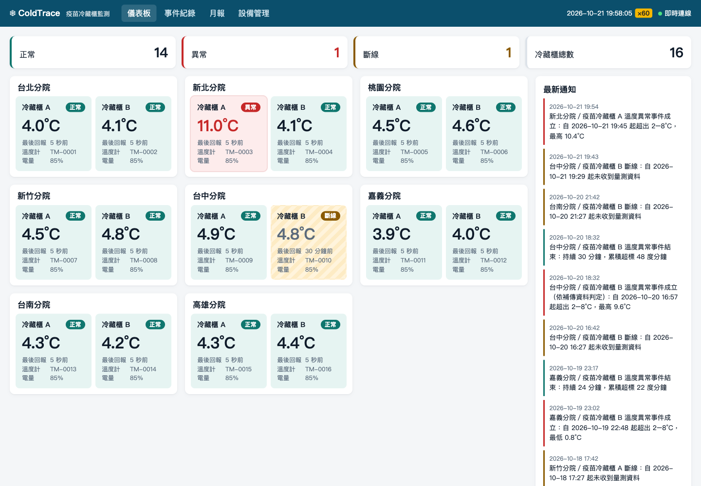
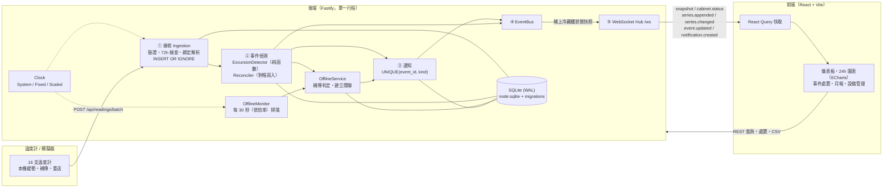
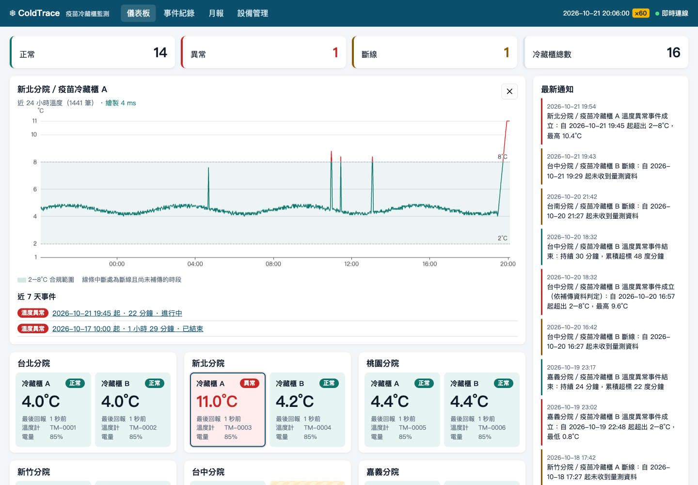
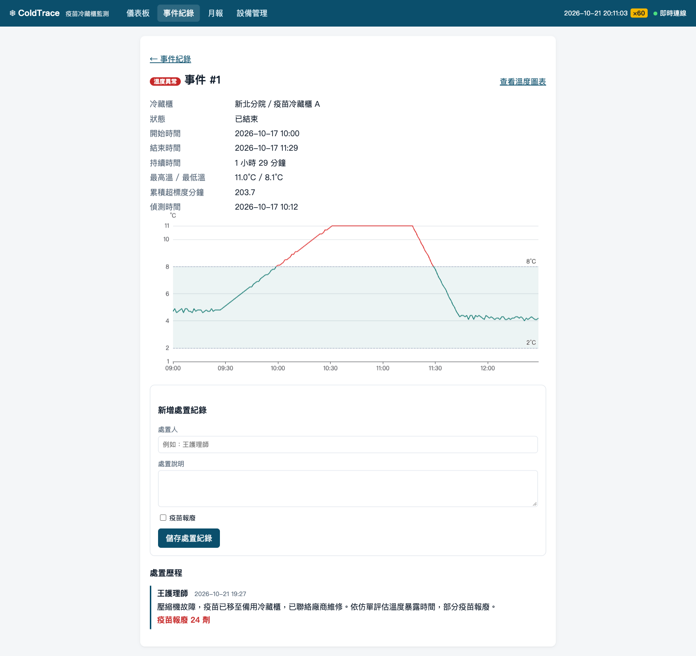
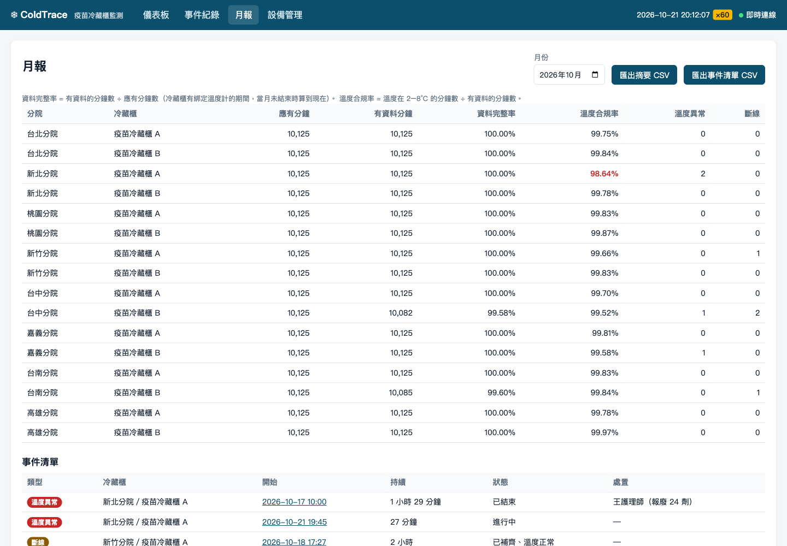

# ColdTrace — 疫苗冷藏櫃溫度監測平台

8 間分院、16 台疫苗冷藏櫃的溫度監測系統。接收 IoT 溫度計每分鐘回報的量測資料（含斷線補傳），
自動判定「溫度異常」與「斷線」事件，透過 WebSocket 即時推播到儀表板，並提供事件處置紀錄與月報。



---

## 快速開始

需求：**Node.js 22.13 以上**（使用內建的 `node:sqlite`，不需要編譯任何原生模組）。

```bash
npm install
npm run dev
```

開啟 <http://localhost:5173>。

`npm run dev` 會同時啟動三個程序：

| 程序           | 位址                    | 說明                                                  |
| -------------- | ----------------------- | ----------------------------------------------------- |
| 後端 (Fastify) | <http://localhost:3000> | 第一次啟動時若資料庫為空，自動產生範例資料（約 3 秒） |
| 前端 (Vite)    | <http://localhost:5173> | `/api`、`/ws` 代理到後端                              |
| 模擬器         | —                       | 16 支溫度計以「正常」情境每分鐘上傳                   |

範例資料：8 間分院 × 2 台冷藏櫃、**過去 7 天每分鐘一筆（約 16.1 萬筆）**，並預埋以下情境：

| 冷藏櫃             | 情境                                | 結果                                     |
| ------------------ | ----------------------------------- | ---------------------------------------- |
| 新北分院／A（C03） | 壓縮機故障約 1.5 小時               | 溫度異常事件，已填處置紀錄（報廢 24 劑） |
| 嘉義分院／B（C12） | 溫控器設定錯誤，過冷至 0.8°C        | 低溫異常事件，已填處置紀錄               |
| 新竹分院／A（C07） | 週末斷電 2 小時，恢復後補傳正常     | 斷線事件「已補齊、溫度正常」             |
| 台中分院／B（C10） | 斷線 2 小時，補傳資料含 30 分鐘超標 | 斷線事件與 30 分鐘溫度異常事件互相關聯   |
| 台南分院／B（C14） | 斷線 40 分鐘，資料遺失未補傳        | 斷線事件「資料不完整」，圖表線條中斷     |
| 桃園分院／A（C05） | 第 4 天更換溫度計                   | 新舊溫度計資料皆歸屬同一冷藏櫃           |
| 全部               | 每天 2–4 次開門短暫升溫             | 不產生事件                               |

> 範例資料不是手寫的假事件：產生腳本以 `FixedClock` 從 7 天前逐步推進時間，
> 資料走與正式環境相同的接收與判定流程，所以事件結果與系統規則一致。

### 其他指令

| 指令                                 | 說明                                                                 |
| ------------------------------------ | -------------------------------------------------------------------- |
| `npm run dev:no-sim`                 | 只啟動前後端（不啟動模擬器；15 分鐘後所有冷藏櫃會顯示「斷線」）      |
| `npm run db:reset`                   | 刪除資料庫並重新產生範例資料                                         |
| `npm test`                           | 執行所有 Vitest 測試                                                 |
| `npm run lint` / `npm run typecheck` | ESLint（type-checked）/ TypeScript 型別檢查                          |
| `npm run build`                      | 建置前端；建置後 `npm start -w @coldtrace/server` 會一併提供前端頁面 |

環境變數（後端）：`PORT`（預設 3000）、`COLDTRACE_DB`（預設 `data/coldtrace.db`）、
`CLOCK_SPEED`（時鐘倍率，預設 1）、`LOG_LEVEL`。

---

## 裝置模擬器

```bash
npm run simulator -- [選項]
```

| 選項                      | 說明                                       |
| ------------------------- | ------------------------------------------ |
| `--scenario <名稱>`       | 所有裝置的情境，預設 `normal`              |
| `--override <裝置=情境>`  | 個別裝置情境，可重複                       |
| `--duration <時間>`       | 模擬長度，例如 `30m`、`2h`；省略則持續執行 |
| `--incident-after <時間>` | 情境開始前的正常時間，預設 `2m`            |
| `--devices <N>`           | 只模擬前 N 支裝置                          |
| `--api <網址>`            | 後端位址，預設 `http://localhost:3000`     |

| 情境                 | 行為                                                                  |
| -------------------- | --------------------------------------------------------------------- |
| `normal`             | 4–5°C 附近小幅波動                                                    |
| `door-open`          | 每 20 分鐘開門一次，5 分鐘內升到約 9.5°C 再降回（不應產生事件）       |
| `compressor-failure` | 每分鐘升 0.25°C 到 11°C，維持 90 分鐘後修復（超標約 88 分鐘）         |
| `offline-backfill`   | 停止上傳 2 小時（存在本機），其中第 40 分鐘起超標 30 分鐘，恢復後補傳 |

模擬器的行為模擬真實裝置：

- **流水號延續**：啟動時向後端查詢每支裝置的最後流水號與量測時間，接續編號（重開機不歸零）；
  中間的空白（例如昨天關機）在 72 小時內的部分會自動補傳。
- **本機緩衝與重送**：離線或上傳失敗時保留在本機，恢復後依時間先後分批（每批 ≤ 1,000 筆）補傳。
- **自動驗證**：指定 `--duration` 時，結束後查詢後端事件，逐台比對情境預期並印出 ✅ / ❌，
  不符或有上傳錯誤即以非零代碼結束。

### 加速展示

「斷線 2 小時」照真實時間要等兩個多小時。所有時間邏輯都透過可注入的時鐘取得，
所以可以用 `CLOCK_SPEED` 讓伺服器時鐘加速，模擬器與前端都會自動跟隨伺服器的倍率：

```bash
# 終端機 1：60 倍速（真實 1 秒 = 模擬 1 分鐘）
CLOCK_SPEED=60 npm run dev:no-sim

# 終端機 2：4 種情境同時跑 150 模擬分鐘（約 2.5 分鐘），結束後自動驗證
npm run simulator -- --duration 150m \
  --override TM-0001=door-open --override TM-0002=door-open \
  --override TM-0003=compressor-failure --override TM-0004=compressor-failure \
  --override TM-0007=offline-backfill --override TM-0010=offline-backfill
```

實際執行結果：

```
上傳 2496 筆：接受 2496、重複 0、拒收 0；上傳錯誤 0 次
情境開始後經過 148 分鐘（模擬時間），事件判定結果：
  ✅ TM-0001（C01，door-open）：無事件（符合預期）
  ✅ TM-0003（C03，compressor-failure）：溫度異常事件 #9
  ✅ TM-0007（C07，offline-backfill）：斷線 #7 補傳後產生 30 分鐘異常 #11 並互相關聯
  ✅ TM-0005（C05，normal）：無事件（符合預期）
  …（16 台全數 ✅）
```

---

## 系統架構



### 一個批次 = 一個 transaction

```
POST /api/readings/batch
  └─ BEGIN
       ├─ ① 逐筆驗證 → 依量測時間解析當時綁定的冷藏櫃 → INSERT OR IGNORE
       ├─ ② 對每個受影響的冷藏櫃重算異常事件（只重算可能改變的視窗）
       ├─    斷線事件：判斷是否恢復、補傳是否補齊、期間是否有超標
       └─ ③ 寫入通知（同事件同種類只會成功一次）
     COMMIT
  └─ ④ commit 成功後才推播（不會推播已回滾的結果）
```

`node:sqlite` 是同步 API，Node 單執行緒下批次之間天然串行，
不需要額外的鎖就能避免「兩個批次同時判定同一段超標」的競態。

### 專案結構

```
packages/shared/     API 契約（zod）、常數、台灣時間工具、溫度情境模型、中文標籤
apps/server/         Fastify 後端
  src/modules/       assets（主檔與綁定）、ingestion、events、notifications、dashboard、reports
  src/infra/         db、migrations、clock、errors
  src/realtime/      EventBus、斷線掃描、資料保存清理
  src/seed/          範例資料產生
apps/web/            React 前端
apps/simulator/      裝置模擬器 CLI
docs/design.md       系統分析與架構設計文件
```

---

## 事件判定規則與邊界

詳細推導見 [docs/design.md](docs/design.md)。

### 溫度異常事件

| 規則            | 定義                                                                                   |
| --------------- | -------------------------------------------------------------------------------------- |
| 超標            | `溫度 < 2.0°C` 或 `> 8.0°C`；**剛好 2.0 或 8.0 算正常**                                |
| 一筆讀值        | 代表 1 分鐘 `[量測時間, 量測時間 + 1 分鐘)`                                            |
| 連續段          | 時間上相鄰的超標讀值，中間沒有正常讀值；**缺資料 ≤ 2 分鐘仍視為連續**，> 2 分鐘切斷    |
| 持續時間        | 最後一筆超標 + 1 分鐘 − 第一筆超標                                                     |
| 成立            | 持續時間 **≥ 10 分鐘**（第 10 筆連續超標讀值進來時成立）；9 分鐘不成立                 |
| 開始 / 結束時間 | 第一筆超標讀值 / 第一筆回到範圍的讀值（若之後是長缺口，以最後一筆超標 + 1 分鐘為結束） |
| 最高溫 / 最低溫 | 事件內超標讀值的極值                                                                   |
| 累積超標度分鐘  | Σ 每筆超標讀值超出範圍的度數 × 1 分鐘（缺口不累計）                                    |

溫度一律以 **0.1°C 為單位的整數**儲存與計算（4.3°C 存 43），度分鐘累加不會有浮點誤差。

**補傳與亂序**：判定是量測序列的純函數，與資料抵達順序無關。新資料進來時，
重算視窗往前、往後各延伸到最近一筆正常讀值（連續段的邊界一定是正常讀值），只重算視窗內的連續段，
再與資料庫中既有的事件對帳：

- 補傳更早的超標 → 事件往前延長（同一個事件編號）
- 補傳填滿兩段之間的缺口 → 兩個事件合併，保留最早的，另一個標記 `MERGED`（不刪除，留下稽核軌跡）
- 補傳出已結束的歷史事件 → 標記「依補傳資料判定」，成立與結束通知各一則

### 斷線事件

| 規則     | 定義                                                                                 |
| -------- | ------------------------------------------------------------------------------------ |
| 成立     | 有綁定溫度計的冷藏櫃，`現在 − 最後一筆量測時間 > 15 分鐘`（剛好 15 分鐘不成立）      |
| 重啟寬限 | 伺服器重啟後，以「最後量測時間」與「服務啟動時間」較晚者起算 15 分鐘，讓溫度計先補傳 |
| 開始時間 | 最後一筆量測時間 + 1 分鐘                                                            |
| 恢復     | 最新量測時間回到 15 分鐘內；結束時間為該筆讀值的量測時間                             |
| 補傳判定 | 恢復時與之後每次有資料落入斷線區間時重新評估                                         |

| 斷線事件狀態     | 條件                                                          |
| ---------------- | ------------------------------------------------------------- |
| 斷線中           | 尚未恢復                                                      |
| 已補齊、溫度正常 | 區間內每分鐘都有資料（容忍 ≤ 2 分鐘缺口），且沒有溫度異常事件 |
| 補傳顯示超標     | 區間內有溫度異常事件，雙向建立關聯（多對多）                  |
| 資料不完整       | 已恢復，但區間內仍有缺口；之後補齊會自動更新                  |

### 冷藏櫃狀態與通知

- 狀態優先序：**斷線 > 異常 > 正常**。超標未滿 10 分鐘時狀態仍為正常，但溫度以紅字顯示。
- 通知三種：溫度異常成立、溫度異常結束、斷線成立。`notifications` 表有 `UNIQUE(event_id, kind)`，
  寫入成功（`changes = 1`）才推播，**同事件同種通知只會有一則**，與資料重送、補傳次數無關。

### 量測接收

| 情況                                | 處理                                                                           |
| ----------------------------------- | ------------------------------------------------------------------------------ |
| `(裝置, 流水號)` 已存在             | 計為重複，不寫入；若內容不同，保留原始紀錄並記 warning log                     |
| 同一冷藏櫃同一量測時間已有資料      | 計為重複，不寫入（防韌體重開機後用新流水號重送）；溫度不同時同樣記 warning log |
| 量測時間早於 72 小時前              | 拒收 `TOO_OLD`（剛好 72 小時接受）                                             |
| 量測時間晚於伺服器 5 分鐘以上       | 拒收 `FROM_FUTURE`                                                             |
| 未知裝置 / 量測時間不在任何綁定期間 | 拒收 `UNKNOWN_DEVICE` / `UNBOUND`                                              |
| 溫度不是小數一位，或超出 −40～60°C  | 拒收 `INVALID_TEMPERATURE`                                                     |

### 溫度計更換

綁定為半開區間 `[起, 迄)`，同一裝置、同一冷藏櫃的綁定期間不可重疊。量測資料**依量測時間**解析當時的綁定，
所以舊溫度計在更換後才補傳的舊資料，仍歸屬原冷藏櫃。綁定只能往未來修改（更換時間不可早於已收到的最後一筆資料），
保證已寫入資料的歸屬不會改變。

### 月報

- 月份邊界以台灣時間（UTC+8，無日光節約時間）切分。
- **資料完整率** = 有資料的分鐘數 ÷ 應有分鐘數（冷藏櫃有綁定溫度計的期間；當月未結束算到現在）。
- **溫度合規率** = 溫度在 2–8°C 的分鐘數 ÷ 有資料的分鐘數。
- CSV（摘要、事件清單兩個檔案）採 UTF-8 BOM + CRLF，Excel 直接開啟中文不亂碼。

---

## API 一覽

所有時間欄位為 epoch 毫秒（查詢參數也接受 ISO 8601）；溫度欄位 `*X10` 為 0.1°C 單位整數。

| Method     | Path                                                          | 說明                                                           |
| ---------- | ------------------------------------------------------------- | -------------------------------------------------------------- |
| POST       | `/api/readings/batch`                                         | 批次上傳量測（≤ 1,000 筆），回傳接受、重複、拒收筆數與拒收明細 |
| GET        | `/api/dashboard`                                              | 依分院分組的冷藏櫃目前狀態                                     |
| GET        | `/api/cabinets/:id/readings?from&to`                          | 量測序列（預設近 24 小時）                                     |
| GET / POST | `/api/branches`                                               | 分院列表 / 新增                                                |
| GET / POST | `/api/cabinets`                                               | 冷藏櫃列表 / 新增                                              |
| GET / POST | `/api/devices`                                                | 溫度計列表（含最後流水號、量測時間、目前綁定）/ 新增           |
| GET        | `/api/bindings`、`/api/cabinets/:id/bindings`                 | 綁定歷史                                                       |
| POST       | `/api/cabinets/:id/device-replacement`                        | 更換溫度計 `{ newDeviceId, at? }`                              |
| GET        | `/api/events?type&status&cabinetId&from&to&limit`             | 事件列表（預設不含已合併）                                     |
| GET        | `/api/events/:id`                                             | 事件詳情（含關聯事件、處置歷程）                               |
| POST       | `/api/events/:id/dispositions`                                | 新增處置紀錄（append-only）                                    |
| GET        | `/api/notifications?limit`                                    | 通知紀錄                                                       |
| GET        | `/api/reports/monthly?month=YYYY-MM`                          | 月報                                                           |
| GET        | `/api/reports/monthly.csv?month=YYYY-MM&kind=summary\|events` | 月報 CSV                                                       |
| GET        | `/api/system/clock`                                           | 伺服器時間與時鐘倍率                                           |
| WS         | `/ws`                                                         | 即時推播                                                       |

**上傳範例**

```bash
curl -X POST localhost:3000/api/readings/batch -H 'content-type: application/json' -d '{
  "readings": [
    { "deviceId": "TM-0001", "seq": 50001, "measuredAt": "2026-10-21T10:00:00+08:00",
      "temperature": 4.3, "battery": 87 }
  ]
}'
# → { "accepted": 1, "duplicated": 0, "rejectedCount": 0, "rejected": [] }
```

**WebSocket 訊息**

| type                   | 時機                                       |
| ---------------------- | ------------------------------------------ |
| `snapshot`             | 連線建立時，所有冷藏櫃狀態                 |
| `cabinet.status`       | 冷藏櫃狀態、溫度、最後回報時間變動         |
| `series.appended`      | 即時新增讀值（前端直接附加到圖表）         |
| `series.changed`       | 補傳改變了歷史區段（前端重抓該冷藏櫃序列） |
| `event.updated`        | 事件新增或變更                             |
| `notification.created` | 新通知                                     |

---

## 畫面

**儀表板**：依分院分組，顯示目前溫度、狀態（正常 / 異常 / 斷線）、最後回報時間；右側為最新通知。


**24 小時溫度圖表**：點選冷藏櫃後顯示，含 2–8°C 參考帶，超標段以紅色標示；斷線且未補傳的時段線條中斷，
補傳後自動連成連續的線。標題列顯示實際繪製耗時（1,441 點約 4–6 ms）。



**事件處置**：事件詳情、事件前後 1 小時溫度曲線、處置紀錄表單與歷程。



**月報**：每台冷藏櫃的資料完整率、溫度合規率與事件清單，可匯出 CSV。



---

## 測試

完整的測試過程、證據與發現的缺陷見 **[測試報告](docs/test-report.md)**。

```bash
npm test                                      # 單元與整合測試
npm run acceptance -- http://localhost:3200   # 黑箱驗收（對執行中的伺服器，建議 CLOCK_SPEED=60）
```

`scripts/acceptance.ts` 只透過 HTTP API 與 WebSocket 操作執行中的伺服器，逐條驗證驗收標準 #1–#12，
每次執行建立獨立的測試資料，可對同一台伺服器重複執行。

共 90 個 Vitest 測試，涵蓋：

| 範圍               | 重點                                                                            |
| ------------------ | ------------------------------------------------------------------------------- |
| 異常判定（純函數） | 9 / 10 分鐘邊界、2.0 / 8.0 邊界、低溫、度分鐘手算、缺口規則、亂序輸入           |
| 對帳               | 重送 3 次與亂序分批只有一則成立通知、補傳往前延長、兩事件合併、歷史事件補傳     |
| 接收               | 重送筆數不變、72h / 75h 邊界並列出流水號、未來時間、未知裝置、無綁定、內容衝突  |
| 綁定               | 更換前後歸屬（半開區間）、舊裝置延遲補傳、重疊拒絕、不可改寫歷史、失敗回滾      |
| 斷線               | 15 分鐘邊界、重複掃描只一則通知、補齊正常 / 含超標並關聯 / 不完整、補傳順序無關 |
| 月報               | 手算完整率與合規率、台灣時間月份邊界、綁定期間、CSV BOM 與跳脫                  |
| HTTP               | 驗證錯誤、推播內容、處置驗證、更換溫度計 API、404                               |
| 前端 / 模擬器      | 缺口插入、即時合併、伺服器時鐘推算、裝置緩衝與重送、情境驗證                    |

### 驗收標準對照

| #   | 標準                                       | 驗證方式                                                                                           |
| --- | ------------------------------------------ | -------------------------------------------------------------------------------------------------- |
| 1   | `npm install` + 一個指令啟動並載入範例資料 | `npm run dev`；`seed/seed.test.ts`                                                                 |
| 2   | 重送 3 次筆數不變                          | `ingestion.test.ts`「同一批資料重送 3 次」                                                         |
| 3   | 75 小時前資料拒收並列出筆數與流水號        | `ingestion.test.ts`「75 小時前的資料被拒收」                                                       |
| 4   | 超標 9 分鐘不成立、10 分鐘成立             | `excursion-detector.test.ts`、`excursion-reconciler.test.ts`                                       |
| 5   | 累積超標度分鐘與手算一致                   | `excursion-detector.test.ts`「累積超標度分鐘與手算一致」（10.3）                                   |
| 6   | 更換溫度計後資料歸屬正確                   | `assets.test.ts`、`app.test.ts`「更換溫度計 API」                                                  |
| 7   | 停止送資料 15 分鐘產生斷線、儀表板顯示斷線 | `offline-service.test.ts`；畫面實測                                                                |
| 8   | 斷線 2 小時補傳含 30 分鐘超標              | `offline-service.test.ts`；模擬器加速實測（見上方輸出）                                            |
| 9   | 「事件成立」通知只有一則                   | `excursion-reconciler.test.ts`「不論重送幾次」                                                     |
| 10  | 不重新整理看到 正常 → 異常 → 正常          | 畫面實測（WebSocket 更新 React Query 快取）                                                        |
| 11  | 1,440 點 1 秒內繪製                        | 面板顯示繪製耗時，實測 4–6 ms                                                                      |
| 12  | 合規率、完整率手算一致；CSV 中文不亂碼     | `report-service.test.ts`、`csv.test.ts`                                                            |
| 13  | 16 台 30 分鐘無錯誤、判定符合情境          | 真實時間實測：上傳 438 筆、錯誤 0、後端錯誤 0，14 台 ✅、2 台斷線中 ⏳（2 小時後才補傳，符合情境） |
| 14  | ≥ 30 個單元測試、lint 無錯誤               | 90 個測試；CI 執行 lint / typecheck / test / build                                                 |

CI：GitHub Actions 於 Node 22 與 24 執行 lint、format check、typecheck、test、build（`.github/workflows/ci.yml`）。

---

## 技術選型

| 層          | 選擇                                                           | 理由                                                                      |
| ----------- | -------------------------------------------------------------- | ------------------------------------------------------------------------- |
| Monorepo    | npm workspaces                                                 | 符合 `npm install` 要求，不需額外工具                                     |
| 後端        | Fastify 5 + `@fastify/websocket`                               | `app.inject()` 免開 port 即可測試 API                                     |
| 資料庫      | `node:sqlite`（內建）                                          | 零原生依賴；`better-sqlite3` 在新版 Node 常無 prebuilt binary，需本機編譯 |
| Migration   | 自寫 runner（`infra/migrations.ts`）                           | 依版本號套用、各自包在 transaction，不引入額外套件                        |
| 驗證 / 契約 | zod 4（`packages/shared`）                                     | 前後端共用 API 型別與驗證規則                                             |
| 前端        | React 18 + Vite 8 + React Router 7 + TanStack Query 5          | WebSocket 訊息直接更新查詢快取                                            |
| 圖表        | Apache ECharts 6                                               | Canvas 繪製、`markArea` 參考帶、`null` 自動斷線                           |
| 測試 / 品質 | Vitest 4、ESLint 9（typescript-eslint type-checked）、Prettier | TypeScript 固定 5.9（typescript-eslint 尚未支援 TS 7）                    |

---

## 已知限制

- **伺服器停機期間**：重啟後先給 15 分鐘寬限，期間溫度計補傳就不會產生斷線事件；
  寬限後仍沒資料才成立事件，開始時間仍是資料真正中斷的時間。代價是伺服器停機前就已斷線的冷藏櫃，
  重啟後要多等 15 分鐘才會再次通知（停機前已成立的斷線事件不受影響）。
- **結束通知的時間點**：若事件因斷線缺口而先被判定結束，之後補傳顯示仍持續超標，
  事件的結束時間會更新，但「事件結束」通知只會在第一次判定時發出一次。
- **連續段被切開**：若之後補傳的正常讀值剛好落在原本被視為連續的 ≤ 2 分鐘缺口中，
  原事件不會被撤銷（通知已發出），只是不再被更新；若切開後的後半段仍滿 10 分鐘，
  會成立為新事件並再發一則「成立」通知。實務上需要裝置對同一缺口先送後補才會發生。
- **每分鐘一筆的假設**：系統假設溫度計每分鐘量測一次；若裝置在同一分鐘內回報多筆，
  每筆都會以 1 分鐘計入累積超標度分鐘（月報以 DISTINCT 分鐘計算，不受影響）。
- **單機 SQLite**：無水平擴充。以 16 台 × 每分鐘一筆 × 2 年（約 1,680 萬筆、1.5–2 GB）的規模足夠；
  量測資料每 6 小時清理一次超過 2 年的部分，事件、通知、處置紀錄保留。
- **歷史綁定不可修改**：只能往未來更換溫度計，以保證已寫入資料的歸屬不變。
- **無登入與權限**：依需求假設僅於診所內網使用，處置人為自由輸入文字。
- **時區**：前端時間顯示固定為台灣時間；圖表橫軸刻度位置依瀏覽器時區計算（在台灣使用時無差異）。
- **前端 bundle** 約 880 kB（主要為 ECharts），內網使用未做拆分。
