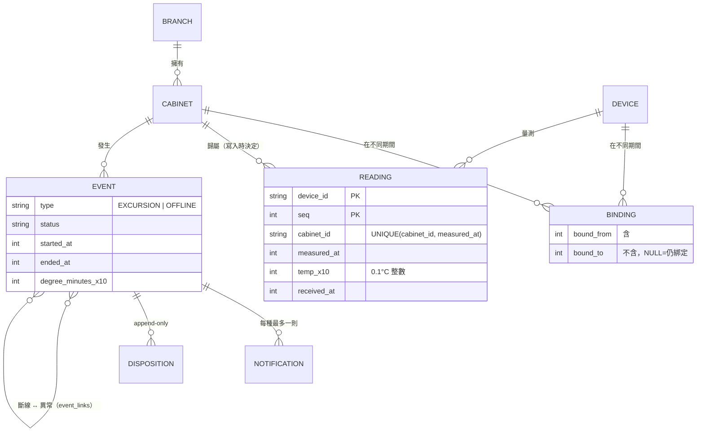
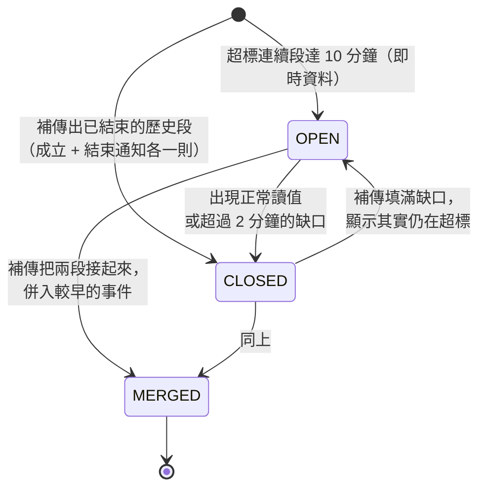
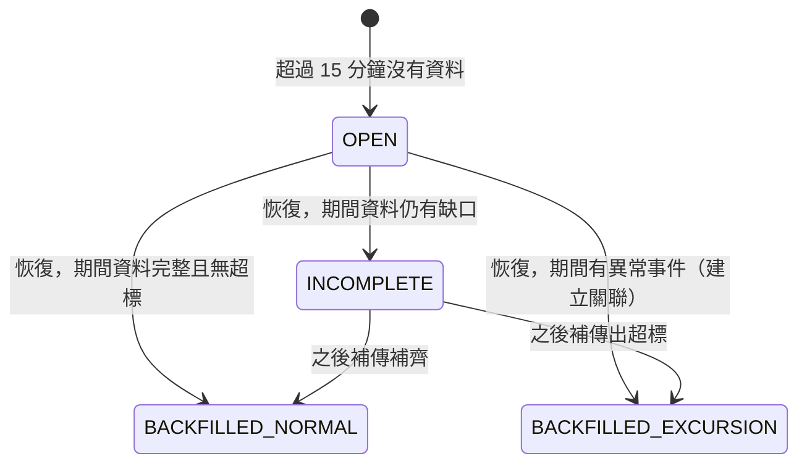

# 第 02 章　系統分析：在寫程式前找出所有的「如果」

> 需求分析回答「要做什麼」，系統分析回答「這個世界長什麼樣子、會怎麼變化」。
> 本章的四個工具：**領域詞彙、領域模型、時間模型、狀態機**。

## 2.1 先找出問題的本質

這個系統表面上是「收資料 → 存起來 → 畫圖」，但如果只這樣理解，寫出來的系統會在第一次補傳時壞掉。
設計文件第 1 節把真正的難點寫成三句話：

1. **資料會亂序、重送、晚到 72 小時**：事件判定不能依賴「資料抵達的順序」。
2. **事件要冪等**：同一段超標不論資料怎麼送，最後只能有一個事件、一則成立通知。
3. **斷線與補傳要能互相解釋**：斷線當下不知道溫度，補傳後要能回頭判定那段期間發生了什麼。

從這三點推出整個系統最重要的設計原則：

> **判定結果 = f(量測資料)**
> 事件是量測資料的**純函數**，資料庫裡的事件只是把 f 的結果「對帳」進去。

如果事件是「資料抵達時一步步累加狀態」得來的，那麼資料抵達順序不同，結果就可能不同；
如果事件永遠是「從現有資料重新算出來」，那麼不論資料怎麼抵達，只要最終資料相同，事件就相同。
第 06 章會看到這個原則如何落實成程式。

## 2.2 領域詞彙（Ubiquitous Language）

團隊對同一個概念要用同一個詞，程式命名也要跟著這個詞。這張表在設計文件 §2 定義，貫穿整個程式碼：

| 中文         | 程式命名        | 定義                                               |
| ------------ | --------------- | -------------------------------------------------- |
| 分院         | `Branch`        | 8 間                                               |
| 冷藏櫃       | `Cabinet`       | 事件與報表的**歸屬主體**（不是溫度計）             |
| 溫度計       | `Device`        | IoT 裝置，可更換                                   |
| 綁定         | `Binding`       | 溫度計與冷藏櫃在 `[boundFrom, boundTo)` 期間的關係 |
| 量測／讀值   | `Reading`       | 一筆代表一分鐘的樣本                               |
| 溫度異常事件 | `Excursion`     | 連續超標 ≥ 10 分鐘                                 |
| 超標連續段   | `Run`           | 時間上相鄰的超標讀值（不一定成立為事件）           |
| 斷線事件     | `Offline`       | 冷藏櫃超過 15 分鐘沒有資料                         |
| 度分鐘       | `degreeMinutes` | 每分鐘超出範圍的度數加總                           |
| 處置紀錄     | `Disposition`   | 事件的人工處理紀錄，只能新增                       |

> **教學重點**：注意「事件歸屬冷藏櫃，而不是溫度計」。疫苗放在冷藏櫃裡，溫度計只是量測工具，
> 換了溫度計，冷藏櫃的歷史要接得起來。這個決定讓 `readings` 表在寫入時就存下 `cabinet_id`。

## 2.3 領域模型



幾個值得討論的建模決定：

- **綁定是有期間的關係**，不是溫度計上的一個 `cabinet_id` 欄位。否則換了溫度計，舊資料就不知道屬於哪台冷藏櫃。
- **斷線與異常是多對多**：一次斷線期間可能補傳出兩段超標；一段超標也可能跨越兩次斷線。
- **兩種事件放同一張表**（`type` 欄位區分）：它們共用起訖時間、處置、通知；各自專用的欄位允許 NULL。
  替代方案是兩張表，查詢「某冷藏櫃所有事件」時要 UNION。對 16 台冷藏櫃的規模，單表較簡單。

## 2.4 時間模型：這個系統最容易出錯的地方

### 兩種時間

| 時間                       | 誰決定 | 用途                                 |
| -------------------------- | ------ | ------------------------------------ |
| **量測時間** `measured_at` | 溫度計 | 所有判定、歸屬、報表                 |
| **接收時間** `received_at` | 伺服器 | 稽核、除錯（例如判斷某筆是不是補傳） |

**所有業務邏輯只用量測時間**。補傳的資料接收時間是現在，量測時間是 2 小時前；
如果用接收時間判定，補傳的超標就會被算在錯誤的時間。

### 一筆讀值代表一分鐘

把每筆讀值看成一個**區間** `[measured_at, measured_at + 1 分鐘)`，而不是一個點。
這個看法讓好幾個規則同時變得一致：

```text
時間軸   0    1    2    3    4    5    6    7    8    9    10   11
讀值    5.0  9.0  9.0  9.0  9.0  9.0  9.0  9.0  9.0  9.0  9.0  5.0
             ├────────────────── 超標 10 筆 ──────────────────┤
             第一筆超標 = 1                     最後一筆超標 = 10
持續時間 = 10 + 1 − 1 = 10 分鐘 → 成立
```

- **持續時間** = 最後一筆超標 + 1 分鐘 − 第一筆超標（10 筆超標 = 10 分鐘，符合直覺）
- **度分鐘** = 每筆超出量 × 1 分鐘的加總
- **斷線開始** = 最後一筆讀值 + 1 分鐘（那筆讀值涵蓋到下一分鐘為止）
- **資料完整** = 區間內每一分鐘都被某筆讀值涵蓋

### 半開區間 `[from, to)`

綁定、月份、斷線區間一律用「含開始、不含結束」：

- 舊綁定 `[D1, D2)`、新綁定 `[D2, null)` → D2 這個時刻只屬於新綁定，**不重疊也不留縫**。
- 10 月 = `[10/1 00:00, 11/1 00:00)`，不需要寫 `10/31 23:59:59.999`。

> **練習**：如果綁定改用閉區間 `[from, to]`，更換時刻的那一分鐘會發生什麼事？

### 時區

資料庫一律存 **UTC epoch 毫秒**（整數），只在顯示層轉成台灣時間。
台灣時間沒有日光節約，所以 `UTC+8` 是固定偏移，月份邊界可以直接計算
（`packages/shared/src/time.ts` 的 `taipeiMonthRange`）。

## 2.5 狀態機

### 溫度異常事件



### 斷線事件



狀態機的價值在於**逼你回答每一條箭頭的觸發條件**，以及「哪些箭頭不存在」。
例如：斷線事件沒有 `RECOVERED` 狀態。設計初期曾有過這個狀態，但它與 `INCOMPLETE` 無法區分
（剛恢復時，補傳可能還沒送完），最後移除，改為「恢復時立即評估，之後每次有資料落入斷線區間就重新評估」。

### 冷藏櫃狀態（衍生，不儲存）

```text
有進行中的斷線事件   → 斷線
否則有進行中的異常事件 → 異常
否則                  → 正常
```

冷藏櫃狀態**不存進資料庫**，每次從事件推導（`dashboard-service.ts` 的 `deriveStatus`）。
能推導出來的東西就不要存，否則就要維護兩份資料的一致性。

## 2.6 用例與參與者

| 參與者             | 用例                                         |
| ------------------ | -------------------------------------------- |
| 溫度計（或模擬器） | 批次上傳量測；斷線時緩衝；恢復後補傳         |
| 系統排程           | 每 30 秒掃描斷線；每 6 小時清除 2 年前的量測 |
| 護理人員           | 查看儀表板與圖表；收到通知；填寫事件處置     |
| 管理者             | 更換溫度計；查看與匯出月報                   |

## 2.7 情境走查：把時間軸畫出來

用時間軸把複雜情境一步步走一遍，是發現設計漏洞最便宜的方法。以驗收 #8 為例：

```text
分鐘     0 ──────── 40 ─────── 80 ─────── 110 ─────── 160 ──▶
溫度計   │ 正常回報  │◀──────── 斷線 120 分鐘（本機緩衝）──────▶│ 恢復，分批補傳
溫度     │   5°C     │   5°C    │ 9.6°C 30 分鐘 │    5°C     │
伺服器   第 39 分鐘收到最後一筆
         第 54 分鐘之後的第一次掃描（現在 − 39 > 15）判定斷線，開始時間 = 第 40 分鐘，發出「斷線」通知
         第 160 分鐘收到恢復後的第一筆即時資料
           → 斷線結束（結束時間 = 該筆的量測時間），評估期間
           → 補傳資料含第 80–110 分鐘的超標
           → 產生異常事件（標記為補傳，成立與結束通知各一則）
           → 斷線事件狀態 = 補傳顯示超標，兩個事件互相關聯
```

走查時要問的問題：

- 補傳是**由新到舊**送，還是**由舊到新**？兩種順序結果一樣嗎？（必須一樣）
- 補傳分成 3 批，第 1 批只涵蓋一半的超標，這時要不要先發通知？（第 06 章）
- 補傳到一半網路又斷了呢？（斷線事件應該是 INCOMPLETE，等之後補齊再更新）

## 2.8 邊界情境清單

把系統分析中找到的所有「如果」整理成清單，每一條都變成至少一個測試：

| 類別 | 情境                             | 期望結果                        |
| ---- | -------------------------------- | ------------------------------- |
| 接收 | 同一批重送 3 次                  | 筆數不變                        |
| 接收 | 同一時間點換流水號重送           | 視為重複（第 10 章的教訓）      |
| 接收 | 剛好 72 小時前 / 75 小時前       | 接受 / 拒收並列出流水號         |
| 接收 | 量測時間在未來                   | 超過 5 分鐘拒收（裝置時鐘異常） |
| 接收 | 溫度 4.25（兩位小數）            | 拒收                            |
| 綁定 | 舊溫度計在更換後補傳更換前的資料 | 歸屬舊冷藏櫃                    |
| 綁定 | 舊溫度計送來更換後時段的資料     | 拒收（無綁定）                  |
| 異常 | 超標 9 分鐘 / 10 分鐘            | 不成立 / 成立                   |
| 異常 | 剛好 2.0°C、8.0°C                | 正常                            |
| 異常 | 超標中間缺 2 分鐘 / 3 分鐘       | 連續 / 切斷                     |
| 異常 | 補傳更早的超標                   | 事件往前延長，不新增            |
| 異常 | 補傳填滿兩段之間                 | 合併為一個事件                  |
| 斷線 | 剛好 15 分鐘 / 15 分鐘又 30 秒   | 不成立 / 成立                   |
| 斷線 | 新綁定、從未回報的冷藏櫃         | 從綁定時間起算                  |
| 斷線 | 伺服器自己停機 2 小時後重啟      | 先給 15 分鐘寬限                |
| 斷線 | 補傳順序（新到舊、分批）         | 結果相同                        |
| 月報 | 9/30 23:50–10/1 00:09 的資料     | 只有 10 筆算進 10 月            |
| 月報 | 當月還沒結束                     | 應有分鐘數算到現在              |

## 2.9 本章練習

1. 為「處置紀錄」畫出狀態機。它為什麼被設計成 append-only，而不是可以修改？
2. 走查情境：溫度計在第 0–20 分鐘超標，第 20 分鐘斷線，第 80 分鐘恢復，補傳顯示第 20–30 分鐘仍然超標。
   畫出時間軸，寫出每個時間點資料庫中的事件與狀態。
3. 2.3 節提到兩種事件放同一張表。列出拆成兩張表的優缺點，並說明在什麼規模或需求下你會改變決定。
