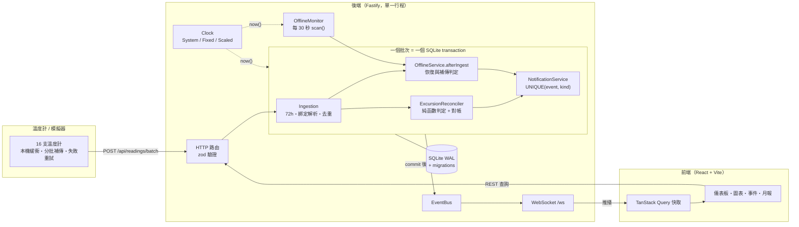

# 第 03 章　架構設計：讓正確性由結構保證

> 好的架構讓「做錯事」變困難。本章的每個設計決定，都在回答：
> **這個不變式（invariant）由誰保證？是靠工程師記得，還是靠結構？**

## 3.1 全貌



## 3.2 六個核心設計原則

### 原則 1：判定是純函數，資料庫只負責對帳

```text
新資料寫入 → 讀出「受影響的時間視窗」內的所有資料 → detectExcursionRuns(資料) → 與資料庫中的事件對帳
```

判定邏輯（`excursion-detector.ts`）不碰資料庫、不看現在時間、不在乎輸入順序。
所以它可以用最簡單的單元測試驗證，而且**同樣的資料永遠得到同樣的結果**。
「怎麼把結果寫進資料庫」是另一個獨立的問題（`excursion-reconciler.ts`）。

> 對照組：如果每收到一筆超標就「計數器 + 1」，那麼補傳、重送、亂序都會讓計數器出錯，
> 而且錯了之後無法從資料修正回來。

### 原則 2：冪等由資料庫約束保證，而不是程式記憶

| 不變式                                 | 保證方式                                                               |
| -------------------------------------- | ---------------------------------------------------------------------- |
| 同一筆讀值只存一次                     | `PRIMARY KEY (device_id, seq)`                                         |
| 同一冷藏櫃同一分鐘只有一筆             | `UNIQUE (cabinet_id, measured_at)`（migration v2）                     |
| 同一事件同種通知只有一則               | `UNIQUE (event_id, kind)` + `INSERT OR IGNORE`，`changes === 1` 才推播 |
| 斷線與異常的關聯不重複                 | `PRIMARY KEY (offline_event_id, excursion_event_id)`                   |
| 同一冷藏櫃同時只有一個進行中的斷線事件 | 應用層檢查（`scan()` 先查 `openEvent`），在同一 transaction 內         |

把不變式放在資料庫約束上的好處：**任何程式路徑**（API、seed、未來新增的批次匯入）都無法違反它。
程式中的 `if (已經發過通知) return` 只保護了寫這行 if 的那條路徑。

### 原則 3：一個批次一個 transaction

`apps/server/src/modules/ingestion/reading-pipeline.ts`：

```ts
process(readings: ReadingInput[]): PipelineResult {
  const now = this.clock.now();
  return transaction(this.db, () => {
    const result = this.ingestion.ingest(readings, now);
    const messages: WsMessage[] = [];

    for (const [cabinetId, range] of result.affected) {
      messages.push(this.seriesMessage(cabinetId, range, result));
      this.excursions.reconcile(cabinetId, range, now, messages);
      for (const hook of this.hooks) hook.afterIngest(cabinetId, range, now, messages);
    }
    return { response: result.response, conflicts: result.conflicts, messages };
  });
}
```

寫入讀值、判定事件、寫入通知，三件事**一起成功或一起失敗**。
不會出現「讀值寫進去了，但事件判定時拋例外，於是這段超標永遠沒有事件」的半套狀態。
注意 `now` 在 transaction 開始前只取一次：整個批次看到的是同一個「現在」。

### 原則 4：commit 之後才推播

pipeline 只**收集**要推播的訊息（`messages`），由呼叫端在 transaction 結束後才送出：

```ts
// apps/server/src/http/routes.ts
app.post('/api/readings/batch', (req) => {
  const body = parse(ingestRequestSchema, req.body);
  const result = s.pipeline.process(body.readings); // transaction 在這裡 commit
  // ...
  s.publish(result.messages); // commit 成功後才推播
  return result.response;
});
```

如果在 transaction 中途就推播，一旦後面失敗回滾，前端就會看到一個資料庫裡不存在的事件。
這是分散式系統中「**outbox pattern**」的單機簡化版。

### 原則 5：所有時間都來自注入的 Clock

```ts
// apps/server/src/infra/clock.ts
export interface Clock {
  now(): number;
  readonly speed: number;
}
```

| 實作          | 用途                                             |
| ------------- | ------------------------------------------------ |
| `SystemClock` | 正式環境                                         |
| `FixedClock`  | 測試：時間只在呼叫 `set()`／`advance()` 時改變   |
| `ScaledClock` | 展示：`CLOCK_SPEED=60` 時真實 1 秒 = 系統 1 分鐘 |

業務程式碼中**不允許出現 `Date.now()`**。這讓「15 分鐘沒資料」的測試只需要
`clock.advance(15 * MINUTE_MS)`，也讓「斷線 2 小時」可以在 2 分鐘內實際展示。
前端也要配合：畫面上的「3 分鐘前」要用**伺服器時間**計算（第 08 章）。

### 原則 6：歸屬在寫入時決定，綁定只能往未來修改

讀值寫入時就依「量測時間當下的綁定」決定 `cabinet_id` 並存起來，查詢時不必再 join 綁定表。
這個優化成立的前提是**綁定的歷史不會被改寫**，所以更換溫度計的 API 只接受
「晚於該冷藏櫃最後一筆資料」的時間（`asset-service.ts` 的 `replaceDevice`）。

> 這是一個典型的取捨：用一個業務限制（不能修改過去的綁定）換取查詢簡單與歸屬永遠不變。
> 這個限制寫在 README 的「已知限制」，讓使用者知道。

## 3.3 一個批次的時序

```mermaid
sequenceDiagram
    autonumber
    participant Dev as 溫度計
    participant API as routes.ts
    participant P as ReadingPipeline
    participant Ing as IngestionService
    participant Rec as ExcursionReconciler
    participant Off as OfflineService
    participant Not as NotificationService
    participant Bus as EventBus → WebSocket

    Dev->>API: POST /api/readings/batch（最多 1,000 筆）
    API->>API: zod 驗證整包格式（錯誤 → 400）
    API->>P: process(readings)
    activate P
    Note over P: BEGIN（SAVEPOINT）
    P->>Ing: ingest(readings, now)
    Ing-->>P: 接受／重複／拒收，<br/>各冷藏櫃受影響的時間範圍
    loop 每個受影響的冷藏櫃
        P->>Rec: reconcile(cabinet, range)
        Rec->>Not: notify(event, EXCURSION_STARTED)
        Note right of Not: INSERT OR IGNORE<br/>changes=1 才回傳通知
        P->>Off: afterIngest(cabinet, range)
    end
    Note over P: COMMIT（RELEASE）
    deactivate P
    P-->>API: response + messages
    API->>Bus: publish(messages)
    API-->>Dev: 200 { accepted, duplicated, rejected }
```

## 3.4 為什麼不需要鎖？

兩個批次同時抵達、都包含同一段超標的資料，會不會產生兩個事件？

`node:sqlite` 是**同步 API**，而 Node.js 是單執行緒。一個批次的 `process()` 從開始到 commit
都在同一個同步呼叫中完成，期間事件迴圈無法處理其他請求。因此批次之間**天然串行**。

```text
請求 A：████████ process() ████████ → 回應
請求 B：                              ████████ process() ████████ → 回應
```

> **思考**：如果改用非同步的資料庫驅動（例如 PostgreSQL 的 `pg`），這個保證就消失了。
> 這時需要 `SELECT ... FOR UPDATE`、advisory lock，或依冷藏櫃分區的佇列。
> 選擇同步驅動不只是效能考量，也是一個**並行控制的設計決定**。

## 3.5 模組切分與依賴方向

```text
apps/server/src/
├─ http/            ← 只做協定轉換：驗證輸入、呼叫 service、轉換錯誤碼
├─ modules/         ← 業務邏輯，依領域切分
│  ├─ assets/          分院、冷藏櫃、溫度計、綁定
│  ├─ ingestion/       接收與 pipeline
│  ├─ events/          異常判定、對帳、斷線、事件查詢
│  ├─ notifications/
│  ├─ dashboard/
│  └─ reports/
├─ realtime/        ← EventBus、斷線掃描排程、資料保留排程
├─ infra/           ← db、migration、clock、錯誤型別（不依賴任何業務模組）
└─ services.ts      ← 組裝所有 service（手動依賴注入）
```

依賴只能往下：`http → modules → infra`。業務模組不知道 HTTP、不知道 WebSocket，
它們只產生 `WsMessage[]`，由外層決定要不要送出、怎麼送出。

依賴注入不需要框架，一個函數就夠了：

```ts
// apps/server/src/services.ts
export function createServices(db: Db, clock: Clock) {
  const assets = new AssetService(db);
  const events = new EventRepository(db);
  const notifications = new NotificationService(db);
  const excursions = new ExcursionReconciler(db, events, notifications, assets);
  const offline = new OfflineService(db, events, notifications, assets, clock.now());
  const ingestion = new IngestionService(db, assets);
  const pipeline = new ReadingPipeline(db, clock, ingestion, excursions, [offline]);
  // ...
}
```

測試時傳入 `:memory:` 資料庫與 `FixedClock`，正式環境傳入檔案資料庫與 `SystemClock`，
其他程式碼完全一樣。

`ReadingPipeline` 透過 `AfterIngestHook` 介面呼叫斷線服務，而不是直接依賴 `OfflineService`：
pipeline 只知道「寫入後要通知一些人」，不知道是誰。未來要加「寫入後更新統計」只需要多掛一個 hook。

## 3.6 資料庫設計

完整 schema 見 `apps/server/src/infra/migrations.ts`。幾個值得說明的決定：

| 決定                                    | 理由                                                                    |
| --------------------------------------- | ----------------------------------------------------------------------- |
| 時間存 `INTEGER`（UTC epoch 毫秒）      | 比較與加減只是整數運算；沒有時區字串的解析問題                          |
| 溫度存 `temp_x10 INTEGER`（4.3°C → 43） | 度分鐘累加不會有浮點誤差（`0.1 + 0.2 !== 0.3`）；手算 10.3 就是整數 103 |
| `readings` 用 `WITHOUT ROWID`           | 主鍵就是 `(device_id, seq)`，省掉一個隱藏的 rowid 欄位與索引            |
| `UNIQUE (cabinet_id, measured_at)`      | 同時作為查詢圖表的索引，以及防止同一分鐘重複的約束                      |
| 事件 `MERGED`／`RETRACTED` 而非刪除     | 被合併或撤銷的事件可能已經發過通知、有人填過處置，刪除會讓稽核軌跡斷掉  |
| 處置紀錄 append-only                    | 法遵稽核：誰在什麼時候做了什麼決定，不能事後修改                        |

### Migration

```ts
// apps/server/src/infra/migrations.ts
/** 只能新增，不可修改已發布的 migration */
export const migrations: Migration[] = [
  { version: 1, name: 'init', sql: `CREATE TABLE ...` },
  { version: 2, name: 'readings_unique_cabinet_time', sql: `DELETE ...; CREATE UNIQUE INDEX ...` },
];
```

runner（`migrate.ts`）約 30 行：建立 `schema_migrations` 表、找出還沒套用的版本、
每個版本包在自己的 transaction 裡執行。**已發布的 migration 不可修改**，因為已經套用過的資料庫不會再執行它；
要改 schema 就新增一個版本。第 10 章的 v2 就是上線後新增約束的真實例子，
它還必須先處理「既有資料已經違反新約束」的情況。

## 3.7 即時推播設計

| 訊息                   | 時機                   | 前端反應                           |
| ---------------------- | ---------------------- | ---------------------------------- |
| `snapshot`             | WebSocket 連線建立     | 覆蓋整個儀表板快取                 |
| `cabinet.status`       | 狀態、最新溫度變動     | 更新快取中的一台冷藏櫃             |
| `series.appended`      | 即時資料（只往後新增） | 把新點直接合併進圖表快取           |
| `series.changed`       | 補傳改變了歷史區段     | 讓該冷藏櫃的圖表查詢失效，重新抓取 |
| `event.updated`        | 事件新增或改變         | 讓事件列表與詳情失效               |
| `notification.created` | 新通知                 | 跳出 toast                         |

`series.appended` 與 `series.changed` 的區分是一個效能與正確性的平衡：
即時資料每分鐘一筆，直接附上新點最省；補傳可能插入到歷史中間，前端自己合併容易出錯，
不如讓它重抓一次。判斷方式很簡單：「這次新增的點數 = 該時段之後的全部點數」就代表純粹往後新增。

16 台冷藏櫃、每分鐘一筆，全部廣播給所有連線即可，不需要訂閱分流。
**不要為不存在的規模設計。**

## 3.8 Monorepo 與共用契約

```text
packages/shared/   ← 前後端共用：zod schema、DTO 型別、常數（2.0 / 8.0 / 10 分鐘…）、台灣時間工具
apps/server/
apps/web/
apps/simulator/
```

「2–8°C」這個數字只在 `packages/shared/src/constants.ts` 出現一次。前端的警示色、後端的判定、
模擬器的驗證都引用同一個常數。API 的請求與回應型別也只定義一次，後端改了欄位，前端會編譯失敗。

## 3.9 本章練習

1. 原則 4 說「commit 之後才推播」。如果推播本身失敗了（例如某個 WebSocket 連線斷了），資料會不一致嗎？為什麼？
2. 假設要支援 10 個後端行程（水平擴充）共用一個 PostgreSQL。列出 3.2 節哪些原則仍然成立、哪些需要改變，以及要怎麼改。
3. 在 3.2 節原則 2 的表格中，「同一冷藏櫃同時只有一個進行中的斷線事件」是唯一靠應用層保證的。
   設計一個資料庫約束來保證它（提示：SQLite 支援 partial index）。
