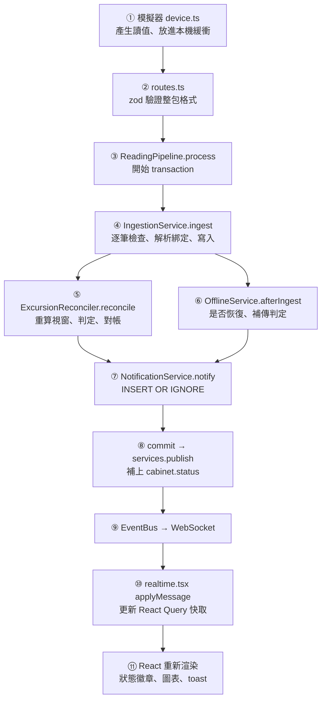

# 第 05 章　程式導覽：跟著一筆讀值走完全程

> 讀一個陌生的程式庫，最有效的方法不是從第一個檔案讀到最後一個，
> 而是**挑一個最核心的資料，跟著它走一遍**。本章跟著一筆溫度讀值，從溫度計走到瀏覽器畫面。

## 5.1 目錄地圖

```text
ColdTrace/
├─ packages/shared/src/        前後端共用
│  ├─ constants.ts               2.0 / 8.0°C、10 / 15 分鐘、72 小時、單批 1,000 筆
│  ├─ api.ts                     zod schema、DTO、WebSocket 訊息型別
│  ├─ time.ts                    台灣時間格式化、月份邊界
│  ├─ temperature-model.ts       模擬器與 seed 共用的溫度模型（確定性亂數）
│  └─ labels.ts                  狀態的中文標籤
├─ apps/server/src/
│  ├─ main.ts                    進入點：開 DB → migrate → 組裝 → 空資料庫時 seed → 啟動排程 → listen
│  ├─ services.ts                手動依賴注入
│  ├─ infra/                     db、migrate、migrations、clock、errors
│  ├─ http/                      app.ts（Fastify、錯誤處理、WebSocket）、routes.ts、validation.ts
│  ├─ modules/
│  │  ├─ assets/                 分院、冷藏櫃、溫度計、綁定
│  │  ├─ ingestion/              ingestion-service.ts、reading-pipeline.ts
│  │  ├─ events/                 excursion-detector.ts ★、excursion-reconciler.ts ★、
│  │  │                          offline-service.ts ★、coverage.ts ★、event-repository.ts
│  │  ├─ notifications/
│  │  ├─ dashboard/
│  │  └─ reports/                report-service.ts、csv.ts
│  ├─ realtime/                  event-bus.ts、offline-monitor.ts、retention.ts
│  ├─ seed/                      以正式流程產生 7 天範例資料
│  └─ test/                      測試共用的 DB、資料、組裝好的 context
├─ apps/web/src/
│  ├─ main.tsx                   路由（儀表板以外的頁面按需載入）
│  ├─ realtime.tsx               WebSocket → React Query 快取
│  ├─ server-clock.ts            依伺服器時鐘推算「現在」
│  ├─ lib/series.ts              圖表缺口插入、即時資料合併
│  ├─ components/                TemperatureChart、LazyTemperatureChart、StatusBadge、Toasts、Layout
│  └─ pages/                     Dashboard、CabinetPanel、Events、EventDetail、Reports、Devices
├─ apps/simulator/src/           device.ts（緩衝與補傳）、scenarios.ts、verify.ts、cli.ts
└─ scripts/acceptance.ts         黑箱驗收：只透過 HTTP 與 WebSocket 驗證 12 條驗收標準
```

標 ★ 的四個檔案是核心演算法，第 06、07 章會逐行解說。

## 5.2 一筆讀值的旅程



### ① 模擬器產生讀值（`apps/simulator/src/device.ts`）

```ts
async tick(now: number, upload: Uploader): Promise<void> {
  while (this.nextAt <= now) {
    this.buffer.push({
      deviceId: this.id,
      seq: ++this.seq,
      measuredAt: new Date(this.nextAt).toISOString(),
      temperature: this.plan.model.sample(this.nextAt),
      battery: 85,
    });
    this.nextAt += MINUTE_MS;
  }
  if (this.isOnline(now)) await this.flush(upload);
}
```

溫度計**一律先放進本機緩衝**，在線上時才送出。這樣「正常上傳」與「斷線後補傳」走的是同一段程式，
差別只在緩衝裡有幾筆。上傳失敗時保留緩衝、下次重送；伺服器端是冪等的，所以重送不會造成重複。

### ② HTTP 路由（`apps/server/src/http/routes.ts`）

```ts
app.post('/api/readings/batch', (req) => {
  const body = parse(ingestRequestSchema, req.body);
  const result = s.pipeline.process(body.readings);
  for (const c of result.conflicts) {
    req.log.warn(c, '流水號重複但內容不同，已保留原始紀錄');
  }
  s.publish(result.messages);
  return result.response;
});
```

路由只做三件事：驗證、呼叫 service、回傳。**整包格式錯誤**（缺欄位、超過 1,000 筆）回 400；
**個別讀值的業務問題**（太舊、未知裝置）不是錯誤，而是在 200 回應中列出被拒收的流水號。
這個區分很重要：一批 1,000 筆中有 1 筆太舊，其他 999 筆仍應該被接受。

### ③ Pipeline 開始 transaction

見第 03 章 3.2 節原則 3。這裡要注意 `transaction()` 的實作（`infra/db.ts`）用的是 **SAVEPOINT**，
所以可以巢狀呼叫：pipeline 開了 transaction，裡面的 `replaceDevice` 或測試輔助函數再開也沒問題。

```ts
export function transaction<T>(db: Db, fn: () => T): T {
  const depth = depthByDb.get(db) ?? 0;
  const name = `sp_${depth}`;
  db.exec(`SAVEPOINT ${name}`);
  depthByDb.set(db, depth + 1);
  try {
    const result = fn();
    db.exec(`RELEASE ${name}`);
    return result;
  } catch (error) {
    db.exec(`ROLLBACK TO ${name}`);
    db.exec(`RELEASE ${name}`);
    throw error;
  } finally {
    depthByDb.set(db, depth);
  }
}
```

### ④ 接收：逐筆檢查（`apps/server/src/modules/ingestion/ingestion-service.ts`）

每一筆依序通過這些關卡，任一關不通過就列入 `rejected` 並處理下一筆：

```text
溫度是小數一位、在 −40～60°C？  否 → INVALID_TEMPERATURE
量測時間 ≥ 現在 − 72 小時？      否 → TOO_OLD
量測時間 ≤ 現在 + 5 分鐘？        否 → FROM_FUTURE
裝置存在？                        否 → UNKNOWN_DEVICE
量測時間當下有綁定？              否 → UNBOUND
INSERT OR IGNORE                  被忽略 → duplicated（內容不同再列入 conflicts）
                                  成功   → accepted，記錄該冷藏櫃受影響的時間範圍
```

兩個細節：

**溫度的整數化**。浮點數 `4.3 * 10` 在 JavaScript 是 `43.00000000000001`，所以先四捨五入，
再檢查四捨五入前後的差距，確認原本真的是小數一位：

```ts
function toOneDecimal(temperature: number): number | null {
  const x10 = Math.round(temperature * 10);
  if (Math.abs(temperature * 10 - x10) > 1e-6) return null; // 4.25 → 拒收
  if (x10 < PLAUSIBLE_MIN_X10 || x10 > PLAUSIBLE_MAX_X10) return null;
  return x10;
}
```

**受影響的時間範圍**。ingestion 回報「每台冷藏櫃實際新增的資料落在哪個時間範圍」，
重複的資料不算。後續的事件判定只需要處理這些範圍；整批都是重複時，範圍是空的，什麼都不用重算。

### ⑤ 異常判定與對帳

第 06 章的主題。這裡只要知道：它讀出受影響範圍附近的資料、用純函數找出超標連續段、
然後新增、延長或合併資料庫中的事件，並把要推播的訊息放進 `messages`。

### ⑥ 斷線恢復判定

第 07 章的主題。如果這台冷藏櫃有進行中的斷線事件，而最新資料已經回到 15 分鐘內，就結束斷線事件，
並判定斷線期間「已補齊、溫度正常」「補傳顯示超標」還是「資料不完整」。

### ⑦ 通知只發一次（`notification-service.ts`）

```ts
notify(eventId, kind, message, now): NotificationDto | null {
  const { changes, lastId } = run(
    this.db,
    `INSERT OR IGNORE INTO notifications (event_id, kind, message, created_at) VALUES (?, ?, ?, ?)`,
    [eventId, kind, message, now],
  );
  if (changes === 0) return null;   // 已經發過了，呼叫端不推播
  // ...
}
```

這段程式不需要知道「之前有沒有發過」。不論被呼叫幾次，資料庫的 `UNIQUE (event_id, kind)` 保證只有第一次會成功。

### ⑧ commit 後推播，並補上冷藏櫃狀態（`services.ts`、`dashboard-service.ts`）

```ts
publish(messages) {
  if (messages.length === 0) return;
  bus.publish(dashboard.withStatusUpdates([...messages], clock.now()));
}
```

`withStatusUpdates` 找出訊息中涉及的冷藏櫃，替每一台附上一則最新的 `cabinet.status`。
業務模組不必各自記得「改了事件要推播冷藏櫃狀態」，集中在一個地方處理。

### ⑨ EventBus 與 WebSocket（`realtime/event-bus.ts`、`http/app.ts`）

```ts
scope.get('/ws', { websocket: true }, (socket) => {
  const send = (message: WsMessage) => {
    if (socket.readyState === socket.OPEN) socket.send(JSON.stringify(message));
  };
  send({ type: 'snapshot', branches: services.dashboard.snapshot(services.clock.now()) });
  const unsubscribe = services.bus.subscribe(send);
  socket.on('close', unsubscribe);
});
```

新連線先收到一份完整快照，之後收增量訊息。斷線重連時再收一次快照，不會漏掉中間的變化。

### ⑩⑪ 前端更新快取（`apps/web/src/realtime.tsx`）

```ts
export function applyMessage(qc: QueryClient, m: WsMessage): void {
  switch (m.type) {
    case 'cabinet.status':
      qc.setQueryData<BranchDashboard[]>(['dashboard'], (old) =>
        old?.map((b) => ({
          ...b,
          cabinets: b.cabinets.map((c) => (c.cabinetId === m.cabinet.cabinetId ? m.cabinet : c)),
        })),
      );
      break;
    case 'series.changed':
      void qc.invalidateQueries({ queryKey: ['readings', m.cabinetId] });
      break;
    // ...
  }
}
```

React 元件只透過 `useQuery` 讀資料，完全不知道 WebSocket 的存在。WebSocket 只是「另一種更新快取的方式」。
這就是驗收 #10「不重新整理就看到 正常 → 異常 → 正常」的實作方式。

## 5.3 另一條路徑：斷線掃描

斷線不是「收到資料」觸發的，而是「**沒收到資料**」觸發的，所以需要排程：

```ts
// apps/server/src/main.ts
const stopMonitor = startOfflineMonitor(
  clock,
  (now) => services.publish(services.offline.scan(now)),
  (error) => app.log.error(error, '斷線掃描失敗'),
);
```

```ts
// apps/server/src/realtime/offline-monitor.ts
const interval = Math.max(MIN_REAL_INTERVAL_MS, SCAN_INTERVAL_MS / clock.speed);
```

掃描間隔是「系統時間 30 秒」：60 倍速時真實間隔就是 500 毫秒，但最短不低於 250 毫秒。
`scan()` 本身是純粹的「給定現在時間，檢查所有冷藏櫃」，測試時直接呼叫，不需要等排程。

## 5.4 範例資料：用正式流程產生

`apps/server/src/seed/seed.ts` 不直接寫入假事件，而是：

1. 用 `FixedClock` 把時間設在 7 天前。
2. 每次推進 5 分鐘，把這 5 分鐘的讀值送進**正式的** `pipeline.process()`。
3. 每次推進後呼叫 `offline.scan()`。
4. 在特定時段讓某些冷藏櫃升溫、斷線、補傳、更換溫度計。

所以範例資料中的每個事件、每則通知，都是正式判定邏輯算出來的。**範例資料與規則永遠一致**，
而且 seed 本身就是一個長達 7 天、16 台冷藏櫃的整合測試。

## 5.5 本章練習

1. 跟著一筆「75 小時前」的讀值走一遍：它在哪一行被拒收？回應長什麼樣子？會不會產生任何 WebSocket 訊息？
2. 跟著一筆「補傳、填滿兩段超標之間缺口」的讀值走一遍，列出它產生的所有 WebSocket 訊息與順序。
3. 如果要新增「電池電量低於 20% 時發通知」，你會把程式放在旅程的哪一站？需要改哪些檔案？
