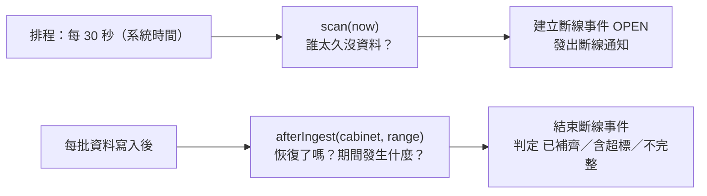

# 第 07 章　核心演算法 II：斷線偵測、補傳判定與資料覆蓋率

> 異常事件是「看到了什麼」，斷線事件是「**沒看到什麼**」。
> 偵測「不存在的東西」需要排程，而判定「那段時間發生了什麼」要等資料補回來。

程式位置：`apps/server/src/modules/events/offline-service.ts`、`coverage.ts`。

## 7.1 兩個入口



## 7.2 偵測：`scan(now)`

```ts
scan(now: number): WsMessage[] {
  return transaction(this.db, () => {
    const out: WsMessage[] = [];
    for (const binding of this.assets.activeBindings(now)) {
      const cabinetId = binding.cabinetId;
      if (this.openEvent(cabinetId)) continue;                   // ❶ 已經在斷線中

      // 從未回報的冷藏櫃以綁定開始時間起算；伺服器重啟後至少等 15 分鐘，讓溫度計有時間補傳
      const lastSeen = this.latestMeasuredAt(cabinetId);
      const silentSince = Math.max(lastSeen ?? binding.boundFrom, this.monitoringSince);  // ❷
      if (now - silentSince <= OFFLINE_THRESHOLD_MS) continue;  // ❸ 剛好 15 分鐘不成立

      const startedAt = lastSeen === null ? binding.boundFrom : lastSeen + SAMPLE_INTERVAL_MS;  // ❹
      // INSERT 事件、發通知、推播
    }
    return out;
  });
}
```

### 逐點說明

**❶ 只掃描有綁定的冷藏櫃，且已在斷線中就跳過**。沒裝溫度計的冷藏櫃不會被誤報；
已經斷線的冷藏櫃不會每 30 秒建一個新事件。再加上通知表的唯一約束，重複掃描只會有一則通知。

**❷「沉默起點」取三者中最合理的**：

| 情況             | 沉默起點           |
| ---------------- | ------------------ |
| 有回報過         | 最後一筆量測時間   |
| 剛綁定、從未回報 | 綁定開始時間       |
| 伺服器剛重啟     | 不早於服務啟動時間 |

最後一列是外部 review 後加上的（第 10 章）。伺服器自己停機 2 小時，重啟的瞬間所有冷藏櫃的
「最後量測時間」都在 2 小時前，原本會同時判定 16 台斷線、發 16 則通知。
但這段時間沒收到資料是**伺服器**的問題，不是溫度計的問題。給 15 分鐘寬限，溫度計就有機會補傳。

**❸ 邊界**：`>` 而不是 `>=`。「超過 15 分鐘」，剛好 15 分鐘不成立。測試用 `FixedClock` 精確驗證：

```ts
ctx.clock.set(at(9) + 15 * MINUTE_MS); // 最後一筆在第 9 分鐘，剛好 15 分鐘
ctx.offline.scan(ctx.clock.now());
expect(eventsOf('OFFLINE')).toHaveLength(0);

ctx.clock.advance(30 * SECOND_MS);
ctx.offline.scan(ctx.clock.now());
expect(eventsOf('OFFLINE')).toMatchObject([{ status: 'OPEN', started_at: at(10) }]);
```

**❹ 開始時間與偵測時間分開**：開始時間是「資料真正中斷」的時間（最後一筆 + 1 分鐘），
偵測時間（`detected_at`）是現在。即使因為重啟寬限而晚了 15 分鐘才偵測，開始時間仍然正確。

> **設計觀察**：「判定是否成立」與「事件內容是什麼」是兩個獨立的問題。
> 寬限期只影響前者，不影響後者。把兩者分開思考，修改時才不會互相干擾。

## 7.3 恢復：`afterIngest`

```ts
afterIngest(cabinetId: string, range: TimeRange, now: number, out: WsMessage[]): void {
  const toAssess = new Set<number>();

  const open = this.openEvent(cabinetId);
  const latest = this.latestMeasuredAt(cabinetId);
  if (open && latest !== null && now - latest <= OFFLINE_THRESHOLD_MS) {   // ❶ 恢復了
    run(this.db, 'UPDATE events SET ended_at = ? WHERE id = ?', [latest, open.id]);
    toAssess.add(open.id);
  }

  const overlapping = SELECT id FROM events                                  // ❷ 補傳落在哪些已結束的斷線裡
    WHERE cabinet_id = ? AND type = 'OFFLINE' AND ended_at IS NOT NULL
      AND started_at <= range.to AND ended_at > range.from;
  for (const { id } of overlapping) toAssess.add(id);

  for (const id of toAssess) this.assess(event, now, out);                  // ❸ 重新判定
}
```

**❶「恢復」的定義**：最新一筆資料回到 15 分鐘內，而不是「收到任何資料」。
如果溫度計恢復後先補傳 2 小時前的資料，那些資料不代表它現在是好的；
等到收到接近現在的資料，才算恢復。結束時間 = 那筆最新資料的量測時間。

**❷ 已結束的斷線也要重新判定**：恢復時補傳可能還沒送完（每批最多 1,000 筆），
所以之後每一批落在斷線區間內的資料，都要讓該斷線事件重新判定一次。

**❸ 判定是收斂的**：與異常事件的對帳一樣，判定只看「現在資料庫裡有什麼」，
所以不論補傳分幾批、什麼順序，最後一批送完後的結果都一樣。

## 7.4 判定：`assess`

```ts
private assess(event: EventRow, now: number, out: WsMessage[]): void {
  const from = event.started_at;
  const to = event.ended_at ?? now;

  // ❶ 斷線期間的異常事件 → 建立關聯（多對多）
  const excursions = this.events.findExcursionsOverlapping(event.cabinet_id, from, to - 1);
  for (const excursion of excursions) {
    INSERT OR IGNORE INTO event_links (offline_event_id, excursion_event_id) VALUES (...);
  }

  // ❷ 斷線期間的資料是否完整
  const times = SELECT measured_at FROM readings
                WHERE cabinet_id = ? AND measured_at >= from − 1 分鐘 AND measured_at < to;

  const status =
    excursions.length > 0           ? 'BACKFILLED_EXCURSION'
    : isFullyCovered(times, from, to) ? 'BACKFILLED_NORMAL'
    :                                   'INCOMPLETE';

  // ❸ 狀態有變才寫入、才推播
  UPDATE events SET status = ? WHERE id = ? AND status != ?;
}
```

注意判定的**優先順序**：有超標就是「補傳顯示超標」，即使資料還不完整。
因為對使用者來說，「這段期間疫苗曾經超標」比「資料不完整」重要得多。

異常事件是在**同一個 pipeline、同一個 transaction 中先跑完對帳**，才輪到斷線判定（第 03 章 3.3 節）。
所以 `assess` 查詢異常事件時，看到的已經是包含本批資料的最新結果。這個**執行順序**是正確性的一部分。

## 7.5 資料覆蓋率演算法：`isFullyCovered`

「斷線期間 `[from, to)` 的資料是否完整？」用的是和異常偵測**相同的連續規則**（缺口 ≤ 2 分鐘可容忍），
否則會出現「異常偵測認為連續、覆蓋率認為不完整」的矛盾。

```ts
export function isFullyCovered(sortedTimes: readonly number[], from: number, to: number): boolean {
  let coveredUntil = from;
  for (const t of sortedTimes) {
    if (t + SAMPLE_INTERVAL_MS <= from || t >= to) continue; // 不在區間內
    if (t - coveredUntil > MAX_CONTINUOUS_GAP_MS) return false; // 出現太大的空白
    coveredUntil = Math.max(coveredUntil, t + SAMPLE_INTERVAL_MS); // 這筆涵蓋到 t + 1 分鐘
  }
  return to - coveredUntil <= MAX_CONTINUOUS_GAP_MS; // 結尾的空白
}
```

這是經典的**區間覆蓋（interval covering）**掃描：每筆讀值是一個長 1 分鐘的區間，
維護「目前涵蓋到哪裡」（`coveredUntil`），檢查下一個區間的起點與它之間的空白。

### 走一遍

斷線區間 `[40, 160)`，補傳資料涵蓋 40–99 與 102–159（缺 100、101 兩分鐘）：

| t         | t − coveredUntil | 判斷  | coveredUntil |
| --------- | ---------------- | ----- | ------------ |
| （開始）  |                  |       | 40           |
| 40        | 0                | ✓     | 41           |
| 41 … 99   | 0                | ✓     | 100          |
| 102       | 2                | ≤ 2 ✓ | 103          |
| 103 … 159 | 0                | ✓     | 160          |
| （結尾）  | 160 − 160 = 0    | ✓     |              |

結果：完整。如果缺的是 100、101、102 三分鐘，第 103 筆時 `103 − 100 = 3 > 2`，回傳不完整。

查詢時往前多抓 1 分鐘，是為了沒有對齊整分鐘的讀值：例如 `from − 30 秒` 的讀值涵蓋到 `from + 30 秒`，
它屬於斷線區間的一部分。剛好在 `from − 1 分鐘` 的讀值只涵蓋到 `from`，會被第一個 `continue` 略過，不影響結果。

## 7.6 補傳順序無關：為什麼成立？

驗收 #8 要求補傳順序不影響結果。拆解來看：

1. **異常事件**：對帳是 f(資料)，資料相同則結果相同（第 06 章）。
2. **斷線結束時間**：取「最新量測時間」，不是「最後收到的那筆」；補傳舊資料不會改變它。
3. **關聯**：`INSERT OR IGNORE`，重複建立無害。
4. **狀態**：每次都從現有資料重新判定，最後一批送完時資料齊了，狀態就是最終狀態。

測試直接用兩種順序各跑一次，比較最終狀態：

```ts
it('補傳順序（新到舊、分批）不影響最終結果', () => {
  /* ... */
});
```

## 7.7 從未回報的冷藏櫃

一個剛綁定、從未回報的冷藏櫃，原本的實作只看「最後量測時間」，因為沒有資料，
所以掉到另一個分支，**在第 14 分鐘就判定斷線**，和「超過 15 分鐘」的規則不一致。
這是 code review 發現的（測試報告缺陷 #1），修正方式是用綁定開始時間作為沉默起點。

> **教學重點**：`null` 是一種邊界情境。每次寫 `?? 預設值` 或 `if (x === null)`，
> 都要問：「這個預設值在業務上代表什麼？它和正常情況的規則一致嗎？」

## 7.8 本章練習

1. 寫出 `isFullyCovered` 的三個測試：資料完全為空、只有開頭缺 3 分鐘、只有結尾缺 3 分鐘。先預測結果再執行。
2. 7.4 節的狀態判定中，如果補傳只送了一半，期間已經看到超標，狀態是 `BACKFILLED_EXCURSION`。
   之後補傳的資料讓那段超標變短到不成立（參考第 06 章 6.7 節），斷線事件的狀態會變成什麼？關聯會被移除嗎？
3. 重啟寬限的代價是：停機前就已斷線、但事件還沒成立的冷藏櫃，重啟後要多等 15 分鐘才通知。
   設計一個能減少這個代價的方案（提示：伺服器能不能知道自己停機了多久？）。
